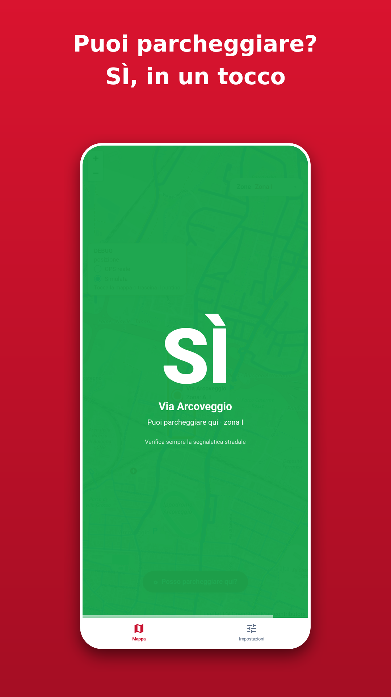
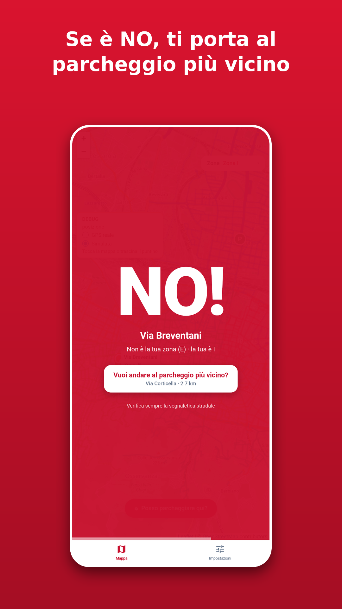
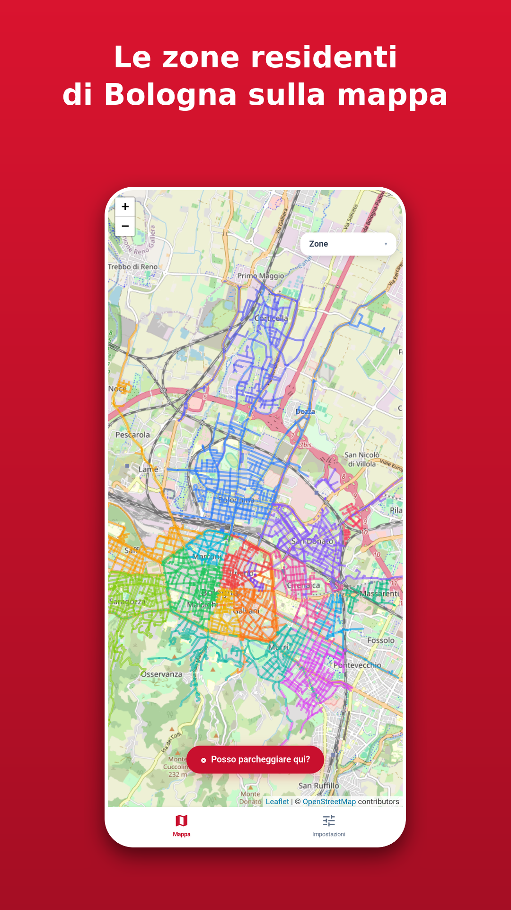
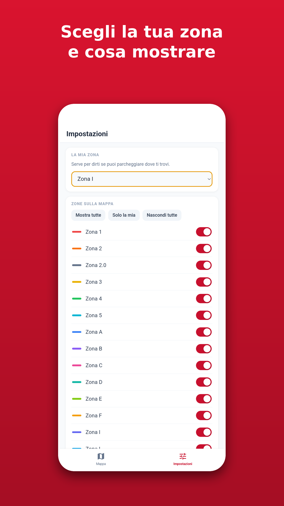
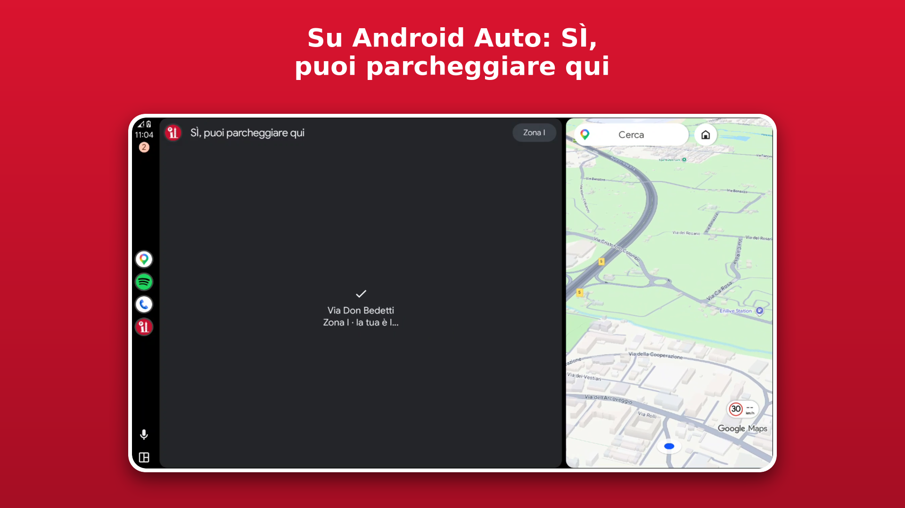
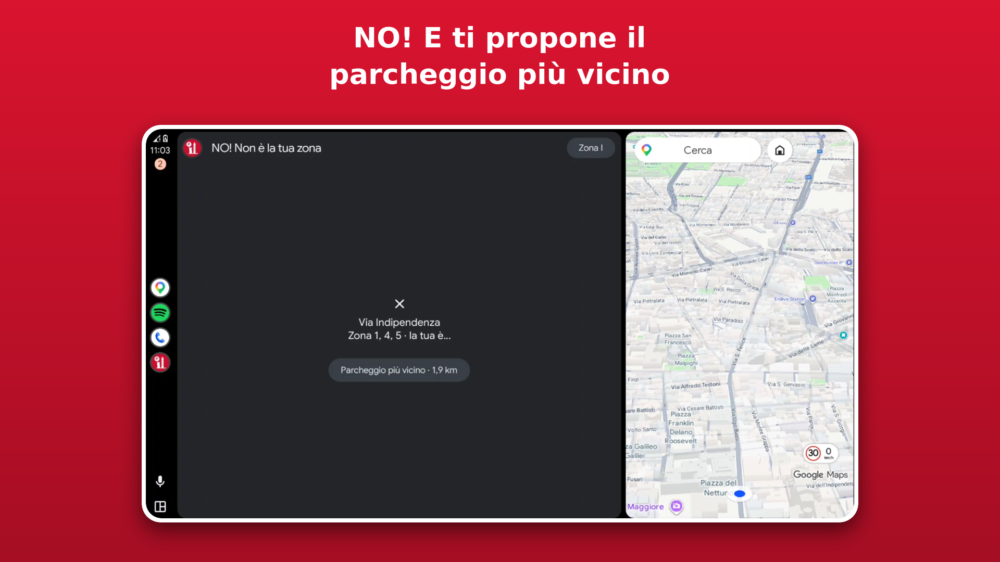

<h1 align="center">ParResBo</h1>

<p align="center">
  <b>Par</b>cheggio <b>Res</b>identi <b>Bo</b>logna<br>
  Le zone di sosta riservate ai residenti di Bologna su una mappa, con una sola domanda: <i>posso parcheggiare qui?</i>
</p>

<p align="center">
  
  
  
  
</p>

<p align="center">
  
  
  
  
</p>

## Cos'è

ParResBo colora ogni via dello stradario comunale in base alla sua zona. Scegli la tua zona e, in base alla posizione del dispositivo, ti dice in grande **SÌ** o **NO!**. Se la risposta è NO!, propone il punto più vicino della tua zona e avvia la navigazione.

Non ha account né pubblicità e la posizione non lascia mai il dispositivo.

## Funzionalità

- Mappa di tutte le zone, con strade colorate per zona (quelle che appartengono a più zone sono tratteggiate)
- Scelta della propria zona e possibilità di mostrare solo quella
- Verdetto SÌ / NO! / "?" in base alla posizione. Lontano da qualsiasi zona (oltre 3 km) non inventa una risposta
- Funziona anche con rete lenta o assente, grazie alla cache del service worker
- Web app installabile (PWA), app Android (WebView) e app nativa per Android Auto
- Il server non riceve mai la posizione: il confronto con le strade avviene sul dispositivo

## Avvio rapido

Richiede Node.js 18 o superiore.

```sh
git clone https://github.com/francescolar/bologna-parcheggio-residenti.git
cd bologna-parcheggio-residenti
npm install
npm start
```

Apri `http://localhost:3000`. Al primo avvio il server scarica le geometrie da Overpass e può impiegare qualche minuto: nel frattempo `/api/streets` risponde `503` con `Retry-After` e il client riprova da solo.

### Docker

```sh
docker compose up -d --build   # http://127.0.0.1:3100  (HOST_PORT per cambiare)
```

La cache sta in un volume Docker e sopravvive ai riavvii.

## Configurazione

| Variabile | Descrizione | Default |
|---|---|---|
| `PORT` | porta HTTP | `3000` |
| `OVERPASS_CONTACT` | email o URL inserito nello User-Agent delle richieste a Overpass | URL del repo |
| `DEBUG_PASSWORD` | password per sbloccare la modalità debug (posizione simulata); vuota = debug disattivato | vuota |

Per attivare il debug: Impostazioni, tocca 5 volte la versione, inserisci la password. È solo un blocco dell'interfaccia, non una protezione dei dati.

## Come funziona

```
open data Comune di Bologna ──┐
                              ├─► server.js ──► /api/streets ──► frontend (Leaflet, PWA)
OpenStreetMap (Overpass) ─────┘   abbinamento       │
                                  per nome          └─► public/geo.js: strada più vicina,
                                                        zona, verdetto (tutto sul dispositivo)
```

- `server.js` (Express) scarica lo stradario e le geometrie, poi le abbina per nome: normalizzazione, tipi composti, numeri in lettere, prefissi e suffissi, correzioni manuali in `CORRECTIONS`. Abbinate 1021 vie su 1023 (restano fuori `DE MELLO (PIAZZA)` e `NETTUNO (PIAZZA)`).
- Le geometrie sono in `cache/` per 7 giorni. Se cambia la query Overpass, incrementa `CACHE_VERSION`.
- `public/` è il frontend. Zona scelta e impostazioni stanno in `localStorage`.
- Il server inserisce nella pagina un identificativo di build: l'app si accorge delle nuove versioni e si aggiorna da sola.

## App Android

Una WebView a schermo intero con barra inferiore nativa (Mappa, Impostazioni), in `android/`. Carica l'indirizzo definito da `BASE_URL` in `android/app/build.gradle`: per usare un tuo server, cambialo.

Per compilare servono JDK 17, Gradle 8.14 e l'Android SDK (piattaforma 36, build-tools 36.1.0).

```sh
cd android
gradle assembleDebug   # android/app/build/outputs/apk/debug/
```

La build di debug ammette il traffico in chiaro (utile con un server locale) e ha un pulsante per cambiare l'indirizzo.

## Android Auto

<p>
  
  
</p>

Nella stessa app c'è una versione nativa per Android Auto, costruita con la [Car App Library](https://developer.android.com/training/cars/apps) (`android/app/src/main/java/dev/laruffa/parresbo/car/`, categoria POI). Mostra SÌ / NO! in base alla posizione del telefono e alla zona scelta e, nel NO!, propone la navigazione verso il punto più vicino della propria zona. La zona è condivisa con l'app.

Android Auto non ammette WebView né browser, quindi l'interfaccia è nativa. La logica è la stessa di `public/geo.js`.

Per provarla con il Desktop Head Unit (l'emulatore di Google) vedi [`docs/android-auto-testing.md`](docs/android-auto-testing.md) e `scripts/dhu.sh`. Per simulare la posizione: `scripts/fake-location.sh`.

## Test

```sh
npm test                                  # JavaScript: matching, API, PWA, geometria (senza rete)
cd android && gradle testDebugUnitTest    # Java: logica per Android Auto
```

## Contribuire

Segnalazioni e pull request sono benvenute. Se trovi una strada sbagliata o mancante, apri una [issue](https://github.com/francescolar/bologna-parcheggio-residenti/issues) indicando via e zona. Prima di una PR esegui `npm test`.

## Licenza

Il codice è rilasciato con licenza [MIT](LICENSE). I dati hanno le licenze indicate qui sotto.

## Dati e crediti

- Zone e strade: [open data del Comune di Bologna](https://opendata.comune.bologna.it), licenza [CC BY 4.0](https://creativecommons.org/licenses/by/4.0/), elaborati da ParResBo
- Mappa e geometrie: © [OpenStreetMap](https://www.openstreetmap.org/copyright) contributors, dati ODbL
- Mappa interattiva: [Leaflet](https://leafletjs.com)

## Avviso

Progetto personale e non commerciale, senza alcun legame con il Comune di Bologna. I dati possono essere incompleti o non aggiornati e il GPS può sbagliare: le risposte sono solo un aiuto e **fa sempre fede la segnaletica stradale**.
